# Native screen references — 9 October 2026

Read these alongside the [as-built specification](../as-built-specification-and-design.md). Each PNG is exactly 1920 × 720 at 96 DPI, rendered from the current compiled WPF visual tree. They are design references, not mockups of a proposed interface.

The exporter does not show a desktop window or fire the app's Loaded initialization. It uses isolated preferences, fixes the clock, leaves media/Spotify disconnected and explicitly displays inactive audio. It substitutes a generic monitor label. The footer labels the images as references. No personal preferences, account tokens, media titles or device names are included. Start menu indexing may start when the editor is constructed, but no app paths or installed-app inventory are published; the reference shows its initial loading choice. Settings Display has fullscreen launch **unchecked in this fixture**, while the product default is **checked**.

These images establish native layout, typography, palette and control treatment. Integration state behavior, connected Spotify browsing, session rows, gestures, disabled/hover/focus states and timings are specified in the main document and exact UI/source appendices. Do not mistake initialization placeholders in the optional metrics reference for measured values. There is no claim that these static images validate physical touch, monitor switching or external accounts.

## 01 · Default dashboard

Midnight, Lime, 100% text, 20 px card corners, six visible default cards. Audio unavailable fixture, no Windows media session, Spotify disconnected.

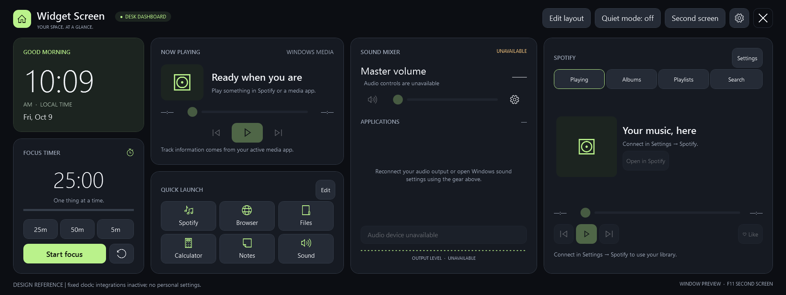

## 02 · Settings — Theme

Live appearance choices, text size, 24-hour clock and output levels. Global Save changes footer and close-to-cancel icon.

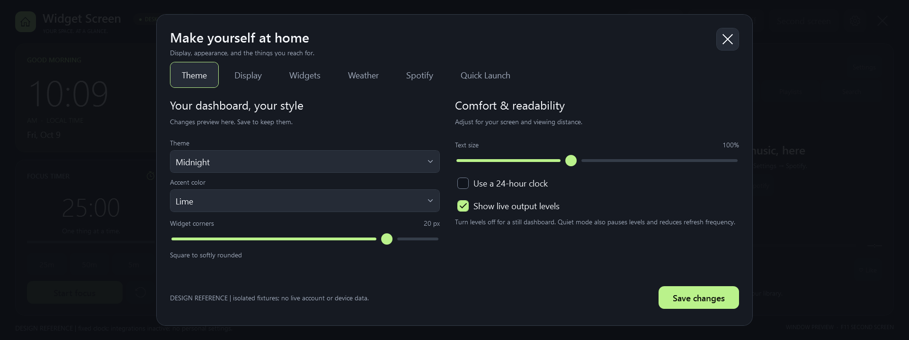

## 03 · Settings — Display

Generic monitor selection fixture and fullscreen launch preference (unchecked for these offscreen renders).

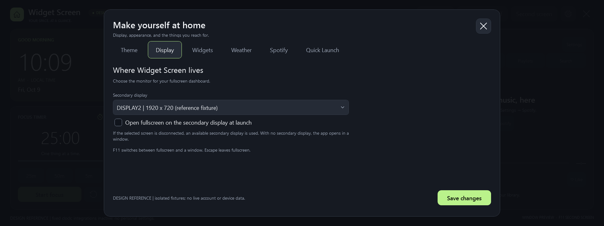

## 04 · Settings — Widgets

Entry to direct layout editing and independent system metric choices.

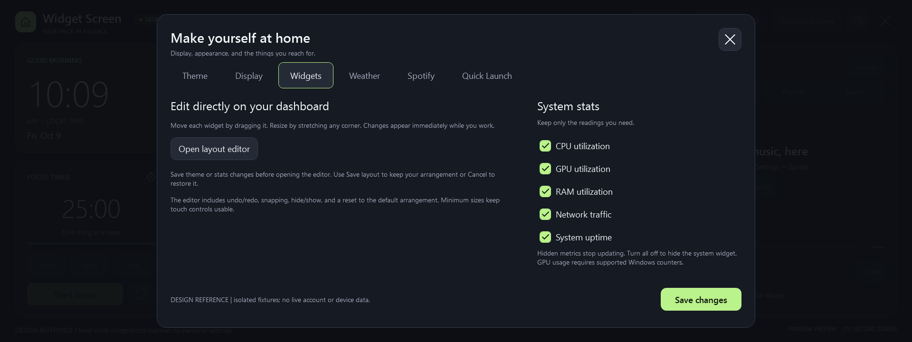

## 05 · Settings — Weather

City search, results selection and weather-off action. Empty location fixture.

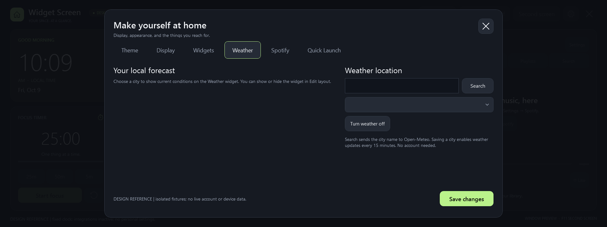

## 06 · Settings — Spotify

Disconnected account form, redirect address, developer instructions and undoable arrangement action. Left region scrolls for its lower explanatory text.

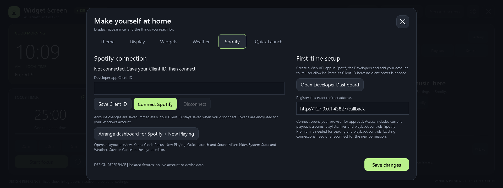

## 07 · Settings — Quick Launch

Six-entry default deck; first entry selected. Both the list and the form can scroll. Arguments are collapsed; confirmation/help below the fold remain accessible by scrolling.

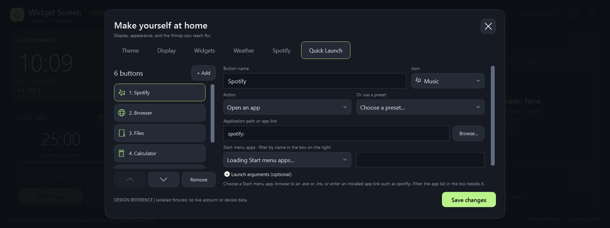

## 08 · Layout editing

Clock selected; visible corner grips and edit toolbar. The documentation label intentionally replaces the normal geometry footer; see §6.2 for the real footer contract.

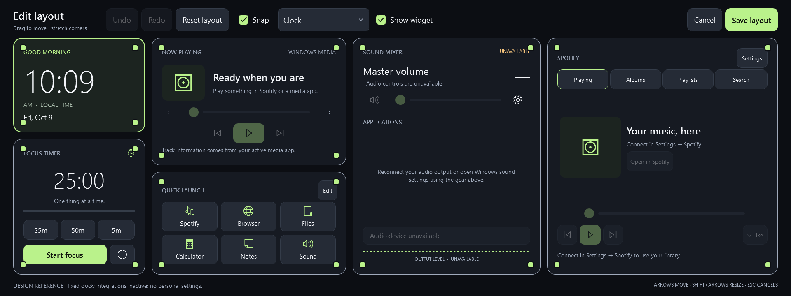

## 09 · Slate / Glacier / 115% text

Same geometry, larger dynamic typography, theme and accent changed. Fixed font sizes and hit areas are unchanged.

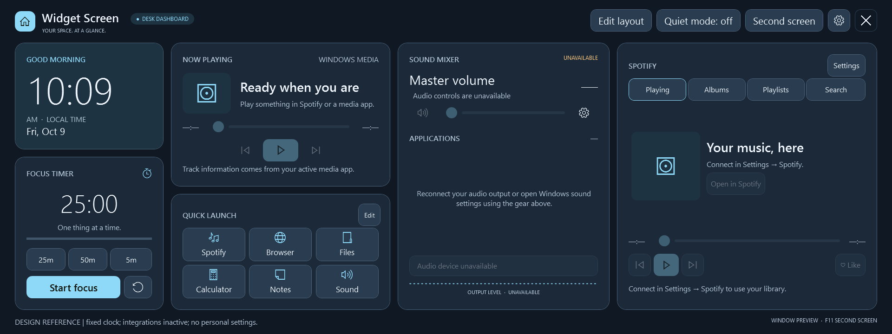

## 10 · Warm / Amber / square cards

100% text, card corner radius 0. Buttons and internal artwork shapes retain their own radii.

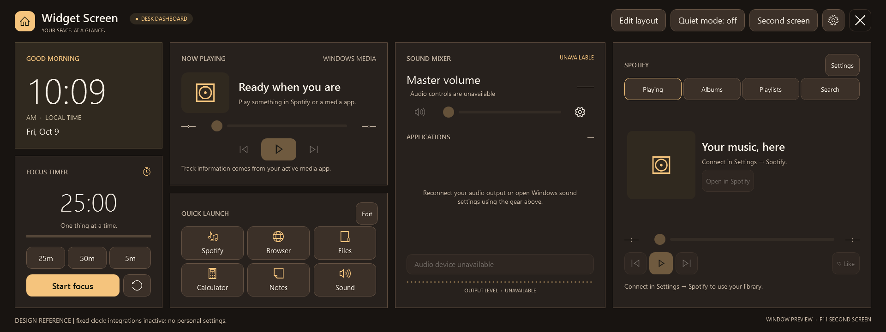

## 11 · Optional widgets / legacy layout

Explicit legacy arrangement with System Pulse and Weather visible and Spotify hidden. Shows the optional cards in their sampling/unconfigured initialization states; no live readings were acquired.

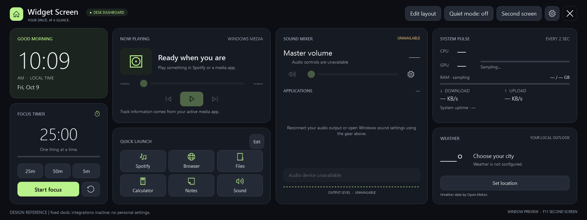

## Recreate these references

From the repository root on Windows:

```powershell
powershell.exe -NoProfile -ExecutionPolicy Bypass -File .\scripts\build.ps1 -Test -OutputDirectory artifacts\specification
powershell.exe -NoProfile -STA -ExecutionPolicy Bypass -File .\scripts\export-design-reference.ps1
```

The exporter accepts `-AppDirectory` and `-OutputDirectory`. To preserve this baseline when rendering a newer version, select a different output directory. The frozen source snapshot contains the exporter used here. Do not run its source archive in place under the live `src` directory; extract it to a separate directory so the recursive build does not compile duplicate source files.
