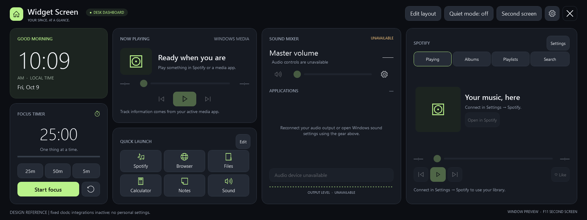

# Widget Screen — as-built specification and design

**Baseline:** 9 October 2026 · application assembly 0.1.0.0 · native Windows WPF · .NET Framework 4.8 · x64.

This is a reconstruction specification for the implementation present in this workspace on the baseline date, including uncommitted changes. It describes the implemented product, rather than the candidate features in AGENTS.md or a proposed redesign. Build the behavior and appearance described here, including the limitations and exceptions. Do not substitute a browser, WebView, different widget arrangement, or a new visual system.

The reference is the current **source**, built and checked for this handoff. It is not a capture of the owner's personal saved layout, accounts, shortcuts, or a possibly older running executable. Time, account content, audio sessions, device names and sensor values naturally vary at runtime.

## Reading and reference package

This document specifies the product, interactions, geometry, visual tokens, persistence and integration contracts. Its companion files provide literal fidelity where prose alone would be ambiguous:

- [Screen references](as-built-reference/screens.md): eleven 1920 × 720 renders of the actual WPF controls, including every Settings tab, editing, alternate themes and optional widgets. These use clearly labelled, isolated display fixtures; they are not simulated readings presented as live data.
- [Exact UI reference](as-built-reference/ui-reference.md): the complete baseline XAML, plus a searchable named-element inventory. This is the normative declaration of every fixed margin, row, column, string, tooltip, template and automation name not repeated here. Runtime overrides in this document and source take precedence over XAML initialization values.
- [Baseline manifest](as-built-reference/baseline.json): SHA-256 hashes, source revision information and the files included in the source snapshot.
- [Normalized default settings](as-built-reference/default-settings.xml): a complete, account-free example of the effective new default layout and serialized preferences.
- [Source snapshot](as-built-reference/implementation-source.zip): the exact application source, build/run helpers, tests and existing project documentation used for this specification. This preserves uncommitted implementation details and external API requests if the live repository changes later. No executables, personal settings, credentials or account data are included.
- [Verification record](as-built-reference/verification.md): checks performed for this handoff and the boundaries of that verification.

For a faithful reconstruction, use the prose for behavior and the XAML/reference package for exact values. Live operating-system and service results remain conditional on the user's PC and account. In a conflict with older planning/design notes or README summaries, the frozen implementation is authoritative for this baseline. Later changes require a new baseline rather than silently changing these references.

**Navigation:** [Product](#1-product-and-scope) · [Runtime/display](#2-runtime-window-and-display-behavior) · [Visual design](#3-screen-geometry-and-visual-system) · [Widgets](#4-widget-contracts) · [Spotify](#5-spotify-widget-and-account) · [Settings/layout editing](#6-settings-and-editing-transactions) · [Quick Launch](#7-quick-launch-editor-and-action-execution) · [Polling](#8-polling-concurrency-and-lifetime) · [Local data](#9-local-data-contract-and-migration) · [Acceptance](#10-reconstruction-acceptance-criteria) · [Source map](#11-source-responsibilities).

## 1. Product and scope

Widget Screen is a single-window personal dashboard for a Windows PC's 1920 × 720 secondary touchscreen. It combines local time, a focus timer, Windows media controls, customizable launch buttons, a Windows sound mixer, Spotify, optional system readings and optional current weather. It is intended to remain glanceable while the user works or plays games, with no scrolling of the dashboard itself.

The app is a native WPF executable with operating-system fonts and icon glyphs. It has no third-party runtime packages, WebView, embedded browser, web frontend, companion server, installer, cloud synchronization, tray interface, startup registration or updater. Browser windows are opened externally for Spotify authorization and links. Only the short-lived Spotify sign-in callback listens on localhost.

The implementation contains eight widget identities; each occurs once. Users can move, resize, hide and restore them, but cannot instantiate duplicates or load third-party widgets. Settings are local XML. The focus session and integration caches are process-local and are not restored after restart.

### 1.1 First-run arrangement

Visible: Clock, Focus timer, Now playing, Quick launch, Sound mixer and Spotify. System stats and Weather exist but are hidden. Spotify starts disconnected. Weather has no location. All five system metric preferences are enabled even though their card is hidden. The default deck contains six actions.

The old seven-card arrangement is still a migration path. A saved custom layout takes precedence over defaults. If there is no saved `WidgetLayout` and all old width/height preferences retain their constructor values with `SwapSideWidgets=false`, initialize the new Spotify arrangement. If any of those old layout preferences differ, derive the legacy arrangement instead; Spotify is hidden in that arrangement.

### 1.2 Deliberate feature boundaries

There are no temperature readings, frequency spectrum, microphone gain, per-app output routing, in-app output-device picker, weather forecast timeline, Spotify audio streaming/capture, queue editing, device transfer, shuffle/repeat, playlist editing, embedded song playback or custom background-image uploader. Weather's Settings heading says “Your local forecast”, but only current conditions are implemented. Output visualization is a history of peak amplitude, not spectral analysis.

Reduced motion is achieved through the explicit output-level preference and Quiet mode; there is no separate implemented operating-system reduced-motion setting. Physical touchscreen comfort and operation against exclusive fullscreen games are unverified hardware constraints, not guaranteed capabilities.

## 2. Runtime, window and display behavior

### 2.1 Build and startup

Build on Windows using the installed 64-bit .NET Framework compiler at `%windir%\Microsoft.NET\Framework64\v4.0.30319\csc.exe`. The build script gathers all `src/**/*.cs`, compiles an optimized x64 Windows executable, embeds `MainWindow.xaml` as `WidgetScreen.MainWindow.xaml`, embeds the manifest and copies `App.config` as `WidgetScreen.exe.config`. No `.csproj`, package restore or separately installed .NET SDK is used.

```powershell
powershell.exe -NoProfile -ExecutionPolicy Bypass -File .\scripts\build.ps1 -Test
powershell.exe -NoProfile -ExecutionPolicy Bypass -File .\scripts\run.ps1
```

Default output: `artifacts/app/WidgetScreen.exe`. Both scripts accept alternate artifact locations (`-OutputDirectory` when building; `-AppDirectory` when running). `run.ps1 -Windowed` passes `--windowed`. The app is STA, loads embedded XAML through `XamlReader`, creates a `DashboardController`, and shuts down when its main window closes. Required references are the Framework WPF, XML, security, HTTP, drawing, Windows Forms and JSON assemblies, GAC WinRT bridge assemblies, and OS `Windows.Foundation`, `Windows.Media` and `Windows.Storage` metadata; the frozen build script specifies the exact list.

Manifest: `asInvoker`, `uiAccess=false`, Windows 10 compatibility declaration, per-monitor DPI awareness (`true/pm`, `PerMonitorV2`). Framework configuration enables touch/stylus and DPI change support and uses OS-default TLS with strong cryptography. Assembly version is 0.1.0.0.

Startup exceptions are logged to `%LOCALAPPDATA%\WidgetScreen\error.log`; a file over 1 MiB is cleared before appending the next error. Normal startup failure shows a native error MessageBox and exits 1. The dispatcher exception handler logs exceptions but does not mark them handled. There is no single-instance guard.

### 2.2 Monitor selection

Enumerate `System.Windows.Forms.Screen.AllScreens`. Fullscreen must select a non-primary screen. Prefer the saved device name if it still denotes a non-primary display. Otherwise choose the secondary screen minimizing `abs(width−1920)+abs(height−720)`; ties retain enumeration order.

At startup, enter fullscreen only if `StartFullscreen=true`, not forced windowed, and a secondary monitor can be selected and positioned successfully. Fullscreen uses normal window state, no window chrome, no resizing, and `SetWindowPos` to the selected screen's physical bounds. It is not topmost. There is no primary-screen fullscreen fallback.

Window preview uses a resizable single-border window centered in the primary screen's working area. Physical width is `min(1536, 90% of working width)`; height is `min(660, 88% of working height)`. XAML initially declares 1536 × 640 and minimum 960 × 400; runtime positioning establishes preview bounds. Window dimensions and position are not saved.

`F11` and the header's “Second screen” / “Window preview” button toggle modes. With no secondary screen, notify “Connect a second display to use fullscreen. This preview stays on the primary monitor.” Display-change events reposition a fullscreen window to the selected/fallback secondary; if none remains, switch to preview and report the disconnect. Changing the saved monitor while already fullscreen repositions immediately after Settings Save. The fullscreen-at-launch checkbox does not itself switch a windowed app to fullscreen.

Escape priority: cancel layout editing; otherwise close Settings if open; otherwise leave fullscreen; otherwise consume Escape without closing the app. F11 can still toggle display mode with Settings open or while editing. The close icon exits the process; there is no unsaved-changes confirmation.

### 2.3 Command-line contract

| Argument | Behavior |
| --- | --- |
| `--settings <path>` | Load/save preferences at this path; Spotify session is stored in the same directory. |
| `--windowed` | Force preview at startup only. |
| `--render <path>` | Force preview; after five seconds render the Dashboard element to a 1920 × 720, 96 DPI PNG and close. |
| `--render-settings` | In render mode, open Settings before capture. |
| `--render-tab <index>` | Select a valid zero-based Settings tab for capture. |
| `--render-edit` | In render mode, enter the layout editor. |
| `--render-edit-demo` | With render editing: move Clock by (32,16), grow its SE corner by (48,24), hide Focus. |

Normal render mode can read real integrations. The documentation-specific exporter instead renders controls offscreen without firing window Loaded, uses isolated preferences, and labels the inactive/fixture data.

## 3. Screen geometry and visual system

### 3.1 Coordinate system

All measurements below are WPF design units at a 1920 × 720 logical reference, not promises about physical millimeters. A `Viewbox Stretch=Uniform` scales the entire dashboard to fit the available client area. Preserve aspect ratio and letterbox as necessary; do not reflow into mobile-style columns. WPF layout rounding, pixel snapping and `TextFormattingMode=Display` are enabled.

The root Dashboard is exactly 1920 × 720. DashboardContent has margins left/right 32, top 20, bottom 16, leaving 1856 × 684. Its rows are header 72, widgets 576 and footer 36. Thus the widget canvas begins at **screen (32,92)** and ends at (1888,668). The footer occupies screen y=668…704, aligned at its bottom.

The original column grid in XAML is dismantled at controller construction. Every card is removed from its declared parent, stripped of external margins/fixed width/height, wrapped in an independent Grid and placed on a clipping Canvas of **1856 × 576**. Implementing only the static XAML column layout produces the wrong app.

### 3.2 Default geometry

Positions are relative to the canvas; add (32,92) to obtain screen coordinates. All new default layer values are 0. The draw/serialization order is Clock, Focus, Media, Shortcuts, Mixer, System, Weather, Spotify; later children paint above earlier children for equal layers.

| ID / title | X | Y | Width | Height | Visible | Minimum size |
| --- | ---: | ---: | ---: | ---: | --- | --- |
| Clock | 0 | 0 | 320 | 230 | Yes | 296 × 200 |
| Focus / Focus timer | 0 | 246 | 320 | 330 | Yes | 296 × 300 |
| Media / Now playing | 336 | 0 | 472 | 310 | Yes | 360 × 310 |
| Shortcuts / Quick launch | 336 | 326 | 472 | 250 | Yes | 420 × 190 |
| Mixer / Sound mixer | 824 | 0 | 456 | 576 | Yes | 380 × 420 |
| Spotify | 1296 | 0 | 560 | 576 | Yes | 560 × 500 |
| System / System stats | 1383.1111 | 0 | 472.8889 | 310 | No | 380 × 310 |
| Weather | 1383.1111 | 326 | 472.8889 | 250 | No | 360 × 220 |

Hidden System/Weather inherit their old default bounds. Restoring them can overlap Spotify: there is no automatic rearrangement. The exact legacy calculation is in §9.3.



### 3.3 Palette

Themes replace the following dynamic brush resources. Accent is independently selectable and does not retint the theme's ClockSurface/ClockBorder/ClockMuted values.

| Resource | Midnight (default) | Slate | Warm |
| --- | --- | --- | --- |
| Page | `#0C0E13` | `#101923` | `#181411` |
| Surface | `#161A22` | `#1B2938` | `#27211D` |
| Raised | `#252B36` | `#293C50` | `#3B3028` |
| Input | `#10141C` | `#142130` | `#1F1915` |
| Track | `#353D49` | `#40546A` | `#544638` |
| ControlBorder | `#343C49` | `#4C637C` | `#665344` |
| Selected | `#394252` | `#3A536E` | `#564534` |
| Muted | `#A0AABB` | `#B6C7DA` | `#C8B8A6` |
| Text | `#F2F4F8` | `#F0F6FF` | `#FAF3E9` |
| ClockSurface | `#1C2420` | `#1E3341` | `#30291F` |
| ClockBorder | `#344235` | `#476175` | `#61533C` |
| ClockMuted | `#A8BAAA` | `#B6CDD9` | `#D2C4A8` |

Accent choices: Lime `#BAF28B` (default), Glacier `#8ED8F8`, Lavender `#C5AEFF`, Amber `#F5C47D`. Warning is fixed `#F5C47D`. Primary button text is fixed `#11170E`; brand icon text is `#10170D`. The Settings scrim stays `#E80C0E13` in every theme. Scroll thumb base is fixed `#606D81` and unchecked checkbox border is `#798598`.

### 3.4 Typography, icons and scaling

Base font is Segoe UI. Clock uses Segoe UI Light; glyph icons use Segoe MDL2 Assets, not images or emoji. No custom font or static artwork is shipped. Artwork arrives from media providers. Most TextBlocks trim at character boundaries with ellipsis.

| Resource / use | Size at 100% | Scaling |
| --- | ---: | --- |
| SmallSize; labels and supporting text | 14 | × TextScale |
| BodySize; default TextBlock/Button/inputs | 18 | × TextScale |
| TitleSize; principal widget title | 24 | × TextScale |
| HeroSize; clock upper limit | 76 | × min(1.06, TextScale), then compact-height cap |
| Brand / tagline / badge | 25 semibold / 11 / 12 | Fixed |
| Settings title / tab labels / section headings | 28 semibold / 18 / 24 | Fixed |
| Focus digits | 54 light, or 42 below 320 card height | Fixed |
| Weather temperature / master percent / CPU/GPU values | 54 / 36 / 28 | Fixed |
| Icon buttons / default deck glyphs | 22 / 24 | Fixed |

TextScale is 0.90…1.15; the UI slider increments by 0.05. It changes dynamic font resources and specified generated labels, not all fixed font sizes, spacing or hit areas. Do not uniformly scale every font in response to this preference. The Viewbox independently scales everything with window size.

Clock digits use `min(HeroSize, max(52, (cardHeight−120)×0.75))`. Quick Launch labels are 15×TextScale, or 14×TextScale when compact. Existing audio session labels are 16×TextScale when settings apply. Text has tabular numerals for clock/focus and Windows media timing.

Important glyphs: home E80F; settings E713; close E8BB; focus E916; reset E777; artwork fallback E93C; previous E892; next E893; play E768; pause E769; sound E767; muted E74F; paging E76B/E76C; move-up/down E70E/E70D. Like uses literal `♡ Like` and `♥ Liked` text.

### 3.5 Shared controls

| Control | Exact treatment |
| --- | --- |
| Widget card | Surface fill, ControlBorder 1 px, padding 24, dynamic corner radius 20 default. Quick Launch padding 20. Clock has its own surface/border. |
| Button | Raised fill, Text foreground, ControlBorder 1 px, padding 16×8, centered content, minimum 48 × 48, hand cursor, fixed radius 12. |
| Button states | White content-area hover overlay opacity .06, pressed .13; keyboard focus Text-colored 2 px outer border; disabled chrome opacity .35. |
| Accent button | Accent fill, dark text, zero border, semibold. |
| Icon button | MDL2 font 22, padding 10; individual controls override backgrounds/sizes as declared. |
| Slider | Range 0…100 unless overridden, minimum height 48, click-to-position, small/large steps 1/5. Track 6 px with radius 3. Thumb hit area 44 × 44; visible circle 30 × 30 with Surface 3 px border. Accent left track/thumb; Track right segment. Focus accent border; disabled opacity .3. |
| TextBox | Input fill, ControlBorder, Accent caret, padding 12×8, minimum height 48, vertically centered text. |
| ComboBox | Custom dark template, 48 minimum height, dropdown scroll area maximum height 260; item padding 12×10, minimum 44 high; selected/highlighted item Selected fill. |
| CheckBox | Minimum height 48; outer transparent focus frame radius 8; 24 × 24 box radius 6 in a 34 px column; accent checked fill with a dark drawn check. Disabled opacity .4. |
| ProgressBar | Accent foreground, Track background, no border, height 5 unless set locally. |
| ScrollBar | Width 24, vertical thumb minimum 44 with radius 5 and margin 8,2,4,2. Muted hover / Accent dragging. No arrow buttons. |
| Tabs | Header padding 24×14, radius 10, margin right/bottom 8. Selected Raised fill with Accent 1 px border and Text foreground; unselected Muted; hover Raised; keyboard focus Text border. |

Touch priority is implemented using these minimums, direct touch capture and vertical panning. Some explicit exceptions exist: microphone control minimum height 42, session mute minimum 44, dropdown items 44. Do not claim every target is 48 px. Settings and inner lists may scroll; the main dashboard does not. There are no decorative animations or transitions.

### 3.6 Header and footer

Header brand at left: 44 × 44 Accent tile with radius 13 and home glyph 23; gap 14; “Widget Screen” over “YOUR SPACE. AT A GLANCE.”; tinted pill “●  DESK DASHBOARD”, radius 14, padding 12×5, offset 25 from brand text. Main actions align top/right: Edit layout; Quiet mode: off/on; Second screen/Window preview; settings icon; transparent close icon. Gaps are 10.

Footer left shows the last status message, Small style, maximum width 1380. It is overwritten by later operations, not a toast with expiration. Initial text: “Ready. A little more control, a little less switching.” Right uses fixed 12 px text: “WINDOW PREVIEW  ·  F11 SECOND SCREEN” or “SECOND SCREEN  ·  ESC TO WINDOW”. Editing replaces both footer messages with editing information.

## 4. Widget contracts

### 4.1 Clock

No controls. Three rows: greeting (auto), centered time/period (*), date (auto). Greeting uses accent and uppercase semibold label styling. Invariant English formatting: time `h:mm` + `AM/PM  ·  LOCAL TIME` by default; `HH:mm` + `LOCAL TIME  ·  24 HOUR` when enabled. Date `ddd, MMM d`. Greeting is “GOOD MORNING” before 12, “GOOD AFTERNOON” before 18, otherwise “GOOD EVENING”. Uses local system time and updates once per second even if the card is hidden or the window minimized. Seconds are not displayed.

### 4.2 Focus timer

Title row has “FOCUS TIMER” and the clock glyph. A centered two-digit minutes/seconds display, status and 0…1 progress bar occupy the flexible center. Three presets, “25m”, “50m”, “5m”, reset the timer to that duration and stop it. Below them a full-width accent Start/Pause/Resume button and 60 px reset column; 8 px gap. Preset row has 6 px gaps and bottom margin 12.

Default duration 25 minutes. A Stopwatch measures elapsed time, so timer correctness is not based on dispatch tick counts. Display rounds remaining seconds upward. Toggle starts, pauses or resumes. Toggling a completed timer resets elapsed and begins the same duration. Reset preserves the current preset duration and stops. Duration API clamps 1…180 minutes, although only three presets are exposed. State is not saved and hidden/minimized timers continue counting.

| State | Status | Main action |
| --- | --- | --- |
| Fresh | One thing at a time. | Start focus |
| Running | Stay with it. You've got this. | Pause |
| Paused after progress | Paused. Pick up when you're ready. | Resume |
| Complete | Session complete. Take a breath. | Start focus |

Completion writes “Focus session complete. Time for a break.” to the footer. No sound, notification, automatic break or Pomodoro cycling is implemented.

### 4.3 Windows Now Playing

Independent of the Spotify API widget and account. Uses Windows' current global media transport session. No session selector. A Spotify session exposed by Windows can appear here while the separate Spotify widget is disconnected.

Internal rows: 28 title, flexible metadata (minimum 86), 48 seek, 54 transport, 26 hint. Metadata has a 116 px artwork column, margin top 12/bottom 4; image container right margin 12, radius 14, ClockSurface; fallback E93C 46 px. Image uses Uniform stretch. Text column has left inset 8, title TitleSize semibold wrapped to max height 66, artist SmallSize, top gap 8; title and artist have full-text tooltips.

Header “NOW PLAYING”; source is WINDOWS MEDIA without a session, otherwise SPOTIFY, CHROME, EDGE based on case-insensitive source ID substring, else MEDIA SESSION. Available title falls back to “Untitled media”; artist falls back to album title, then “Your active media session”. No session: “Ready when you are” / “Play something in Spotify or a media app.”; timing `—:—`; controls disabled. Read failure: “Media unavailable”, “Open Spotify or another supported media app.”, source NOT CONNECTED, cleared artwork/timing, hint “Waiting for a media session. Retrying automatically.”

Transport: previous, accent play/pause width 76, next; side gaps 14. Enable each only if the current session reports that capability. Hint shows Playing on this PC, Playback paused, or the idle explanation. Seek row reserves 52 left and 60 right for times; minutes are unbounded integers, seconds two digits.

Read every 3 seconds, or 6 in Quiet mode. Requests do not overlap; suppress refresh while a command or scrub is in progress. Windows timeline position is relative to StartTime, extrapolated on each read using LastUpdatedTime and PlaybackRate only when playing and the time delta is between zero and one day, then clamped. This widget does not have Spotify's separate one-second visual extrapolation. Cache artwork by `source|title|artist`; accept under 8 MiB, decode to width 320, freeze WPF bitmap. Thumbnail failure retains metadata.

Seeking re-reads current session/title/artist, rejects a changed key or unsupported timeline, clamps to [0, duration−1 ms], adds timeline StartTime and calls `TryChangePlaybackPositionAsync` in ticks. Transport uses `TrySkipPreviousAsync`, `TrySkipNextAsync`, `TryTogglePlayPauseAsync`. Rejected commands produce a footer message. No global media-key injection is used for this widget.

### 4.4 Quick Launch

Card padding 20, 48 px header then flexible deck. Header “QUICK LAUNCH”, right-side Edit, and paging when needed. The grid always has three columns. Height ≥240: two rows/six entries per page; below 240: one row/three entries. Page index starts at zero, clamps after deck/size changes, and is not persisted. Previous/next buttons do not wrap; unavailable directions are disabled. Counter shows `1/2` etc. Empty deck shows “+ Add your first button”.

Buttons have margin 4, padding 8, accent glyphs and centered labels. Normal glyph 24, vertical content, label top gap 8 and max width 138. Compact glyph 18, horizontal content, label left gap 8 and max width 70. Tooltip displays target plus arguments, or the built-in action name. Blank targets are disabled; unavailable nonblank assignments are validated when tapped. Button AutomationProperties.Name is the saved label.

| Default label | Action | Target | MDL2 glyph |
| --- | --- | --- | --- |
| Spotify | App | `spotify:` | E8D6 |
| Browser | Website | `https://www.google.com` | E774 |
| Files | App | `%windir%\explorer.exe` | E8B7 |
| Calculator | App | `%windir%\System32\calc.exe` | E8EF |
| Notes | App | `%windir%\System32\notepad.exe` | E70B |
| Sound | App | `ms-settings:sound` | E767 |

No maximum deck size is imposed. Preserve order, old assignments and intentionally empty decks. Execution behavior and the editor are specified in §7.

### 4.5 Sound mixer and output levels

Internal row heights: 34 header, 66 master metadata, 52 master controls, 42 applications header, flexible scrollable sessions, 100 microphone/levels. Header SOUND MIXER and accent `●  LIVE` when readable, Warning-colored UNAVAILABLE on output failure. Master title TitleSize, friendly output-device name SmallSize max width 310, percentage 36 light in an 80 px right column. Control columns: 58 mute, flexible volume slider with 8 px horizontal margin, 60 sound-settings gear.

Use Windows Core Audio COM. Output endpoint is default render role Multimedia (flow 0, role 1). Set scalar volume in [0,1], display rounded percent; mute button toggles endpoint mute. Gear opens `ms-settings:sound`. Poll reconnects if default device ID changes. Master state is independent of session enumeration: session failure leaves master usable and says “App volumes are unavailable. Master volume still works.”

Enumerate endpoint audio sessions by session instance identifier. Exclude expired state 2; inactive sessions can remain. Name is display name, except PID zero → System sounds; blank or resource-style `@...` name → process name; disappeared process → Audio application. Do not merge same-process sessions. Rows are reused by ID and removed when absent; surviving rows keep insertion order. Row height 74, top gap 8, label row 24, columns 48/flexible/48. Label 16×scale, percent fixed 14; mute below label left, volume slider spanning remaining columns with left margin 10. App slider/mute operates `ISimpleAudioVolume`, not master volume.

Default microphone is capture role Communications (flow 1, role 2). A full-width button toggles its endpoint mute; label “Microphone on  ·  tap to mute” or “Microphone muted  ·  tap to unmute”; muted label Accent. Missing microphone disables the button with “No default microphone”. There is no microphone-level slider.

Output failure disables master slider/mute/microphone, clears session rows and count, shows MasterPercent `—`, Audio controls are unavailable, Audio device unavailable and reconnect guidance. Audio actions catch failure, write “The audio device changed or is unavailable. Reconnecting…” and re-read. Polling never overwrites a slider under active mouse/touch capture. Values are refreshed every 2 seconds, or 5 in Quiet mode.

Peak display samples `IAudioMeterInformation.GetPeakValue` every 100 ms only with readable audio, ShowLevels true, mixer visible, non-minimized window, Quiet mode off and layout editing off. It contains 48 samples, shifted left per sample. Each bar: step=availableWidth/48; width=max(1,step−4); height=2+sqrt(clamp(peak,0,1))×max(0,height−2), vertically centered, radius 2, Accent brush. Stopping clears history but still renders 2 px baseline marks. It does not capture PCM or perform an FFT. Status explicitly says LIVE, UNAVAILABLE, PAUSED WHILE EDITING, PAUSED IN QUIET MODE or OFF.

### 4.6 System stats / System Pulse

Hidden by default. Card heading is SYSTEM PULSE; layout selector calls it System stats. Title row 28 then vertical metric stack. CPU row 44 (columns 56/76/flexible), GPU row 48 with same columns, RAM section margins 0,6,0,10, network margin bottom 8, uptime last. All five sections have independent visibility preferences. The whole card is effectively hidden when all metrics are off, even if its placement says Visible=true.

CPU: compute system-wide utilization from successive `GetSystemTimes` idle/kernel/user deltas; kernel includes idle. Clamp 0…100. First sample is unavailable. Show rounded percent and a 48-sample Accent sparkline (2 px stroke, round joins) inside a 32 px high clipped canvas. Points are right-aligned: x=width×(48−count+i)/47, y=30−CPU×.28.

GPU: use English PDH `\GPU Engine(*)\Utilization Percentage`, double format with NOCAP100. Two samples required; initial Sampling…. Group valid nonnegative finite readings by the substring beginning `luid_`, remove duplicate `#...` suffix, sum processes per physical engine, take the maximum engine total across all adapters, cap at 100. Do not sum all engines/adapters or select the highest individual process. Show rounded percent and Busiest engine. Unsupported counters show `—` / Unavailable and retry initialization after one minute. Counter failure does not suppress CPU/RAM. Pausing GPU closes its query and resets retry delay.

RAM: GlobalMemoryStatusEx; used=(totalPhysical−availablePhysical)/2^30, total=totalPhysical/2^30, percent=used/total×100. Display one decimal `used / total GB` and rounded `RAM · n%` with a progress bar. Labels say GB even though the divisor is binary.

Network: aggregate IPv4 byte statistics for Up interfaces, excluding Loopback and Tunnel. Derive bytes/second from UTC elapsed time and cumulative counters; clamp negative deltas to zero. Initial sample or changed set of interfaces needs a new baseline. Display integer KB/s using /1024, or one-decimal MB/s at ≥1,048,576 bytes/sec. There is no adapter selector or bandwidth speed test.

Uptime: GetTickCount64 → `Uptime  ·  Nd Hh Mm`. Sampling executes off the UI thread, one request at a time, every 2 seconds/5 in Quiet mode. Hidden metrics skip their native reads. Hidden cards stop scheduled refresh. A refresh already in flight may complete; hiding is not cancellation of every pending operation. General failure clears graphs and values to unavailable, rather than leaving apparently current readings.

### 4.7 Weather

Hidden by default and unconfigured. Current conditions only, Celsius and km/h, no unit preference. Heading WEATHER with condition right-aligned. Internal rows 26, flexible weather content, 48 button, 20 attribution. Content columns 108 temperature/flexible city. Temperature 54 light; city BodySize with tooltip, details Small. Card height <250 changes city to one ellipsized line max height 28; otherwise wrap to max height 58. Details wrap to max height 46.

Unconfigured: `—°`, Choose your city, Weather is not configured., YOUR LOCAL OUTLOOK, Set location, Weather data by Open-Meteo. Set location opens Settings tab 3 and focuses CitySearch. Configured button refreshes directly. During a request button shows Updating… and disables. Success rounds current temperature; details `Feels N°C  ·  N km/h`; attribution `Open-Meteo  ·  updated HH:mm` using local retrieval time. Failure condition is OFFLINE; retain earlier in-memory values if any and show “Showing earlier data. Tap to retry.”, otherwise “Can't reach weather. Tap to retry.” Restore Refresh weather button after completion.

Visible configured weather requests every 15 minutes from the last attempt, not last success; explicit refresh can run sooner, but concurrent requests are refused. Changing/clearing a saved location invalidates previous asynchronous results, resets the cache and refreshes if visible. No weather data is persisted. HttpClient timeout 12 seconds.

City search requires at least two trimmed characters and sends an escaped name to `https://geocoding-api.open-meteo.com/v1/search?count=5&language=en&format=json&name=...`. Display city, admin1 if present, country if present. Up to five results; selection is explicit. Clear schedules weather-off on Save. Search results cannot reopen the UI after Settings is closed/reopened because requests carry a settings generation.

Current request: `https://api.open-meteo.com/v1/forecast?latitude=...&longitude=...&current=temperature_2m,apparent_temperature,weather_code,wind_speed_10m&timezone=auto`, invariant numeric coordinates. All four current fields must be present/non-null. Condition mapping: 0 Clear skies; remaining codes ≤2 Partly cloudy; 3 Overcast; 45/48 Foggy; 51…57 Drizzle; 61…67 Rain; 71…77 Snow; 80…82 Rain showers; 85/86 Snow showers; ≥95 Thunderstorms; otherwise Conditions unavailable. This records the implemented comparisons, not an expanded weather-code catalog.

### 4.8 Shared media scrubbing

Both media widgets use the same `PlaybackScrubber`. Timing units are milliseconds; slider maximum=max(1,duration). Enable only with a current item key, positive duration and provider seek permission. Small keyboard change=5000 ms; large change=15000 ms. Support arrows, Home/End and PageUp/PageDown through native slider behavior.

Pointer position maps to `clamp((x−24)/max(1,actualWidth−48),0,1)×duration`. Capture mouse or the first touch; preview time locally throughout the gesture. Send one seek on release, not per move or per polling update. Keyboard interaction starts a gesture on navigation keydown and commits on keyup/lost focus. Escape/capture loss cancels and restores the observed position. Item-key change or capability loss cancels an active gesture. A provider must also verify the item identity before executing a seek.

## 5. Spotify widget and account

### 5.1 Card design and navigation

Spotify is a full-height separate card with minimum 560 × 500. Internal rows: header 48, navigation 56, flexible now-playing/library view, seek 48, transport 56, status 44. Header SPOTIFY at left, Settings button right. Four equal tab buttons Playing, Albums, Playlists, Search with 4 px gaps; active tab uses Accent border. All browsing is inline and leaves bottom playback/like controls visible.

Playing view: 160 px artwork column, 148 × 148 artwork/fallback centered vertically (radius 12, ClockSurface, fallback glyph 44). Metadata left inset 8, TitleSize semibold wrap max height 96; artist Small wrap max height 58 with 8 px vertical margins; Open in Spotify button. Seek time columns are 52 each. Transport buttons previous/play/next are left-aligned with 6 px gaps; Like button right-aligned. Status Small wraps in the bottom 44 px with a full-message tooltip.

Disconnected: Your music, here / Connect in Settings → Spotify.; no image; controls disabled; library tabs can be selected but only explain connection requirements. They do not launch sign-in. On connection reset: Loading Spotify… / Checking current playback. Connected without playback: Nothing playing / Start music in Spotify on any device. Failure: Spotify unavailable / Check your connection in Settings → Spotify.; image and timing cleared.

Albums loads saved albums. Playlists loads the user's accessible playlists. Search has a text field (max 200 characters), Find button, and Enter-to-search. No search-as-you-type. Results load ten entries per page, with Previous/Next and a `1–10` range label. Each row is a Button minimum height 70, padding 12×8, bottom margin 6, title BodySize semibold and subtitle Small with 3 px gap. No thumbnail per result. Scroll to top after loading a page. Empty results say “No results. Try another search or save music in Spotify.”

Tap album/playlist → inline collection title with Back and Open Spotify; load its tracks. Tap song or episode → external `https://open.spotify.com/...` link through the shell, not a direct play request. Back resets to the first page of the parent tab. Switching tabs clears list, collection and paging. Stale request generations cannot replace a newer tab/account result. A collection access failure retains Open Spotify; no alternative scraping or ownership bypass is implemented.

### 5.2 Playback, likes and artwork

Poll current playback every 10 seconds, 30 in Quiet mode. Stop initiating polls when hidden, minimized or editing layout; cancel an active scrub then. One-second Tick locally advances displayed playback position from the last observation while playing and clamps at duration. No independent always-running Spotify timer. Commands and scrubbing suspend polling. Playback errors schedule the next poll 60 seconds later; explicit actions have their own updates. Successful transport sets the next poll to one second later; seeking to two seconds later.

Enable previous/play/next only when a parsed current item exists, saved connection has modify-playback scope, and no command is busy. The UI does not independently precheck Premium; the API can reject an enabled command. Play changes to pause based on last observed playback. There is no device picker. Existing connections without the additional scope show reconnect guidance.

Like is enabled only for a standard track URI with known saved-state response and no like request pending. Reset known liked state when item URI changes. Check saved status for a new track and at most once a minute thereafter during playback polls. Change button to `♥ Liked` only after API success; failures do not falsely commit the desired state. Podcasts cannot be liked here. Local items do not pass the standard URI parser.

Item URIs must be `spotify:<track|album|playlist|episode>:<22 alphanumeric characters>` to produce a web link. Missing name → Untitled. Subtitle joins artists by comma, then show name / owner display name / item type as fallback. Choose the last image in the item's image array, or album images. Only download `https` images with a host ending `.scdn.co`, up to the configured 2 MiB buffer with 10-second timeout, decode width 192. No permanent artwork disk cache. Artwork failure leaves the fallback icon and allows retry on later refresh.

### 5.3 API contract as implemented

These are the baseline's literal requests, not a guarantee of future Spotify availability or policy. This specification documents code; it does not re-certify external service policies.

| Operation | HTTP / path under `https://api.spotify.com/v1/` |
| --- | --- |
| Current | GET `me/player/currently-playing?additional_types=episode` |
| Albums | GET `me/albums?limit=10&offset=N` |
| Playlists | GET `me/playlists?limit=10&offset=N` |
| Search | GET `search?type=track&limit=10&offset=N&q=<escaped>` |
| Album tracks | GET `albums/{id}/tracks?limit=10&offset=N` |
| Playlist items | GET `playlists/{id}/items?limit=10&offset=N`; accept nested `item`, then legacy `track` fallback |
| Liked status | GET `me/library/contains?uris=<escaped track URI>`; require one boolean |
| Like / unlike | PUT / DELETE `me/library?uris=<escaped track URI>` |
| Previous / next | POST `me/player/previous` / `me/player/next` |
| Play / pause | PUT `me/player/play` / `me/player/pause` |
| Seek | PUT `me/player/seek?position_ms=N` after verifying a fresh current item |

Seek requires matching current URI, positive duration and no `actions.disallows.seeking=true`. Clamp target to [0,min(Int32.MaxValue,duration−1)] then convert to integer. No direct seek on a stale song. Paging's next-enabled comes from the API `next` field, not inferred result count.

All API calls share a semaphore; timeout is 15 seconds. Before requests, refresh tokens if expiry is within 60 seconds. API 401 forces a refresh and retries once; repeated 401 clears authorization and asks reconnect. Invalid-grant refresh clears tokens, preserving Client ID. Transient server/network failure retains saved refresh credentials. Successful refresh preserves an omitted refresh token and scope and writes the new session atomically.

429 honors Retry-After date or delta, defaults to one minute; error body containing QUOTA_EXCEEDED pauses for one hour. The shared gate rejects requests locally until retry time, including library requests. 403 reports app-owner Premium, user allowlist and permission guidance. Player 404 reports no active Spotify device. Other non-success statuses show an unavailable message with numeric status. Empty success bodies are allowed. Disconnect increments generation so in-flight responses cannot recreate the connection.

### 5.4 Account setup and persistence

Setup is Settings → Spotify (index 4). Fields/buttons: connection status; Developer app Client ID (max 32); Save Client ID; Connect/Reconnect Spotify; Disconnect; Cancel sign-in only during a pending attempt; Arrange dashboard for Spotify + Now Playing. Right column contains setup instructions, Open Developer Dashboard and readonly redirect URI.

Client ID validation: exactly 32 hexadecimal characters. Save Client ID and Connect save that ID to the current `settings.xml` immediately; a failed preference save prevents browser launch. Connect uses the system browser with Authorization Code + PKCE S256, random 32-byte base64url verifier and independent state, `show_dialog=true`, no client secret. Exact callback: **`http://127.0.0.1:43827/callback`**. Bind TcpListener to loopback port 43827, not all interfaces. Only accept GET `/callback?...` with matching state and code or error; read at most 16 KiB of headers. Unrecognized callbacks are rejected while the listener keeps waiting. Overall attempt timeout three minutes; Cancel sign-in, closing Settings or disposing the app cancels it. Port contention gives an actionable message.

Requested scopes: `user-read-currently-playing user-library-read user-library-modify playlist-read-private playlist-read-collaborative user-modify-playback-state`. Token endpoint: `https://accounts.spotify.com/api/token`, URL-encoded code/verifier or refresh-token grant. Report browser success only after valid access/refresh tokens are encrypted and saved; callback is plain UTF-8 text, no-store, Connection: close, 200 success or 400 failure. A browser closing after successful persistence must not undo the login.

Credential file: `spotify-session.dat` in the settings file's directory. JSON payload contains ClientId, AccessToken, RefreshToken, Scope, ExpiresUtc, encrypted using Windows DPAPI CurrentUser without extra entropy; write temporary file then replace/move. This binds credentials to the Windows account, not an executable folder. `Connected` means a refresh token is present; `CanControl` also requires the modify-playback scope. Startup load failure preserves the unreadable file and displays reconnect guidance. A valid ID from an older credential file migrates into preferences when preferences loaded without warning and have no ID.

Disconnect immediately replaces the encrypted session with one containing Client ID only, resets rate-limit state and leaves the preference ID. It does not delete the credential file or revoke the remote Spotify grant. General Settings Cancel cannot undo a completed account change. General Save accepts a valid ID or preserves saved ID if blank; changing the ID alone does not reconnect the existing token session.

Current quirk to preserve: `SpotifyAccount` initializes its TextBox at construction, and opening Settings calls Prepare without resetting that text from saved preferences. An unsaved ID edit can remain visible after closing/reopening Settings, although it is not persisted until a saving action. This differs from normal draft fields.

Arrange dashboard closes Settings using Cancel semantics, enters editing, and inserts the new default arrangement as one undoable change. Unsaved general settings are discarded; account actions already committed remain. Save layout commits the arrangement; Cancel/Undo restores the previous layout.

## 6. Settings and editing transactions

### 6.1 Settings overlay

Full-screen overlay on the root, scrim #E80C0E13. Centered card is **1260 × 660**, at (330,30), padding 28, regular theme card radius/border. Interior rows: header 60, flexible tabs, footer 62. Header “Make yourself at home” (28 semibold) and “Display, appearance, and the things you reach for.”; top-right close icon. Footer reserves 170 px for Save changes and uses the remaining width for wrapped status, with 20 px right margin.

Disable DashboardContent underneath; keyboard Tab and Control+Tab navigation cycle inside the overlay. Opening normal Settings selects Theme and focuses its tab; widget-specific links then select their respective tabs. Tabs in exact order:

| Index | Tab | Fields / actions | Layout |
| ---: | --- | --- | --- |
| 0 | Theme | Theme; accent; widget corners 0…24 step 4; text size 90…115 step 5; 24-hour clock; live output levels | 570 px left, 32 gap, remaining right |
| 1 | Display | Secondary monitor; fullscreen-at-launch | Left-aligned stack max width 780 |
| 2 | Widgets | Open layout editor; CPU/GPU/RAM/network/uptime checkboxes | 740 px left scrollable, 32 gap, remaining right |
| 3 | Weather | City search, Search, results dropdown, Turn weather off | 700 px explanatory left, 32 gap, remaining right |
| 4 | Spotify | Account and layout controls from §5.4 | 740 px scrollable left, 32 gap, remaining right |
| 5 | Quick Launch | Transactional deck editor from §7 | 320 px list, 24 gap, remaining scrollable form |

Opening Settings copies deck/location/general choices to a draft view. Palette/accent/corners/text size preview immediately, through dynamic resources; 24-hour clock, levels, stats, monitor and launch preference wait for Save. Theme preview refreshes editor geometry-dependent typography; generated controls with directly assigned font/brush values need not preview every value until settings are applied. No all-settings Reset button exists.

Save validates Spotify ID and deck across all tabs, builds a new complete settings object retaining custom geometry, Quiet mode and legacy fields, writes it atomically, then applies. Error leaves dialog/draft open and shows the error. Deck error selects Quick Launch and the bad entry. Close or Escape discards unsaved general changes and restores saved appearance, re-enables dashboard, focuses Settings button, cancels pending sign-in and invalidates city searches. Account saves are the explicit immediate exception. Switching tabs preserves draft edits. Opening the layout editor from Widgets closes Settings and discards its draft; visible helper text tells the user to save first.

### 6.2 Layout editor

Editor replaces normal header brand/actions, keeps the dashboard visible and places transparent gesture overlays over cards. Header columns 225 / flexible / 260. Left title “Edit layout” (25 semibold), subtitle “Drag to move · stretch corners” (13). Center: Undo, Redo, Reset layout, Snap, widget selector width 220, Show widget. Right Cancel and accent Save layout. No settings overlay is open during editing.

All visible widgets display four 48 × 48 corner hit targets, containing centered 16 × 16 Accent grips with 2 px Page border and radius 4. The card outline uses CardRadius: selected 2 px Accent, others 1 px Muted. Selected widget temporarily paints at Int32.MaxValue z-index so its corners can be reached through overlaps. Whole non-corner surface drags; corner NE/NW/SE/SW resizes. Underlying widget controls do not receive pointer hits. One mouse gesture or one captured touch is active at a time; ignore other touches.

Coordinates come from the fixed design canvas, accounting for Viewbox scaling. A tap selects only: start changing geometry only after movement reaches 2 design px on either axis. Dragging clamps the card fully inside canvas. Resizing anchors the opposite corner and clamps to widget minimums and canvas boundaries. Snap applies `Math.Round(value/8)×8` (Framework default midpoint rounding) to proposed edges/position before bounds/minimum clamps; it does not snap to other widgets. Keyboard always uses exact deltas without snap.

Moving/resizing to different bounds assigns `max(current layers)+1`. On release or lost capture, a changed gesture becomes one undo entry; unchanged gestures do not add history. Capturing loss ends the gesture rather than restoring its starting bounds. A different selected widget alone does not alter saved stacking order. Overlap is permitted, with no packing, collision prevention or automatic neighbor movement. Report overlaps only when intersection width and height both exceed 1 px.

Begin stores a full layout copy, clears history, selects the first effectively visible widget or Clock if all are hidden. Undo/Redo store full placement snapshots; Remember limits undo to 50. New changes clear redo. Hide/show, Reset and Arrange Spotify are undoable. Selection and Snap toggling themselves are not undo entries. Reset uses the Spotify default and preserves metric choices. Snap is saved alongside placements on successful Save; Cancel restores saved Snap.

| Key | Editing behavior |
| --- | --- |
| Arrows | Move selected widget 8 px. |
| Ctrl+arrows | Move 1 px. |
| Shift+arrows | Resize at SE corner by 8 px. |
| Ctrl+Shift+arrows | Resize at SE corner by 1 px. |
| Ctrl+Z | Undo. |
| Ctrl+Y / Ctrl+Shift+Z | Redo. |
| Escape | Cancel entire editing session. |

Arrows retain dropdown navigation while widget selector has focus. Undo/redo disable during a pointer gesture. Hidden widgets remain selectable; Show widget restores at their old coordinates. System can have Show widget checked but remain invisible because all metrics are off; footer explains this. All widgets can be hidden without losing access to editor controls.

Footer gives `Title · roundedWidth × roundedHeight · X roundedX, Y roundedY`, hidden/disabled-stat guidance when relevant, then “Widgets overlap” when any overlap exists. Right footer: ARROWS MOVE · SHIFT+ARROWS RESIZE · ESC CANCELS. Save writes XML first; failure restores the settings object's prior layout/snap while keeping the visual draft and editor open. Successful Save applies the layout, refreshes integrations and focuses Edit layout. Cancel restores saved placements and focuses Edit layout. Closing the app loses unsaved layout without a prompt.

Output levels and Spotify new polls pause during editing. Other visible system/audio/Windows media/weather polling is not globally suspended. This is an editing overlay, not an app-wide paused state.

## 7. Quick Launch editor and action execution

Edit in the widget and the empty-deck call to action both open Settings → Quick Launch. Left list displays count, + Add, then numbered icon/name buttons (minimum 56 high, padding 12, bottom gap 8); selected border Accent. Up/down reorder one position, Remove deletes immediately from draft without execution or external effects. Removing last entry leaves the empty editor. New entry: “New button”, App, blank target, E8A7 icon; focus/select name text. No autosave of draft.

Form: name max 40; icon picker; action picker; preset picker; context-specific target field max 2048 with 110 px Browse column when applicable; App-only Start menu dropdown/filter and collapsed optional arguments expander (arguments max 2048); Control-only built-in picker; help text; Ask before running. Switching action clears target and arguments. Choosing preset replaces the selected entry, including its label/icon. Choosing Start menu app or file auto-names only if current name is “New button”. Arbitrary existing glyphs are retained even if not offered in picker.

Icon options (MDL2): App E8A7, Globe E774, Folder E8B7, Calculator E8EF, Notes E70B, Music E8D6, Sound E767, Microphone E720, Keyboard E765, Play E768, Clock E916, Settings E713, Star E734, Camera E722, Game E7F4, Document E8A5. Presets are the six defaults, Screenshot (`Win+Shift+S`, Camera) and every built-in control below. Most generated control presets use Sound glyph; microphone and focus use their own.

Start menu indexing runs once on demand per editor instance, on a worker task, reads `.lnk` files in per-user/common Programs, recurses at most eight levels and avoids directory reparse points. Skip inaccessible directories. Deduplicate by display name using current-culture case-insensitive comparison, sort names, filter by substring. No timer or full package-manager app discovery. Empty matches say “No matches — use Browse”. App picker accepts `.exe`/`.lnk`; file picker all files; folder picker disallows creating folders. Dialogs are owned by main window.

Save captures all entries. New/changed target assignments must validate. If a pre-existing entry has a nonblank label and unchanged action/target/arguments identity, its validation error is ignored so an offline drive/app does not block unrelated settings. This exception also applies to renaming/reordering or changing its icon/confirmation. Returned list is copied; label/target trimmed. Cancel restores the saved deck. An XML `<Shortcuts />` means empty, not restore defaults.

### 7.1 Action types and validation

| Action ID | Requirement / behavior |
| --- | --- |
| App | Existing absolute `.exe` or `.lnk`, or supported registered app URI. Expand environment variables. ShellExecute with separate Arguments only for App. |
| File | Existing absolute file; opens using Windows association. No arguments. |
| Folder | Existing absolute directory; opens via shell. No arguments. |
| Website | Absolute http/https URI with nonempty host; open default browser. |
| Hotkey | Modifier sequence plus one Windows Key enum key, or a single key. Send to remembered external app. |
| Control | A supported control ID from the table below. |

Every button needs a nonblank label and target. URI app links reject whitespace, file URIs and schemes javascript/vbscript/data/http/https/shell. Spotify and ms-settings schemes are explicitly accepted; others require HKCR scheme with URL Protocol registration. App URIs reject separate arguments. Files/paths reject invalid path characters and non-rooted paths. Validate again at execution time, including unchanged legacy assignments.

| Control ID | Action |
| --- | --- |
| play / previous / next | Windows media toggle / previous / next, independent of Spotify API. |
| mute / microphone | Toggle default output / communications microphone mute. |
| volume-up / volume-down | Add/subtract 0.05 scalar master volume, clamped by audio service. |
| focus | Toggle current focus timer. |
| quiet | Toggle Quiet mode, apply and persist immediately. |
| sound | Open `ms-settings:sound`. |

Windows media control actions use the session cached by the last Media widget read. If that widget has never read a session (for example, hidden from startup), a control can report rejection rather than independently requesting a session. Audio actions do create their service lazily when needed. Preserve this distinction when reproducing the current behavior.

Confirmation is a native OK/Cancel MessageBox, Cancel default, showing label + inspectable action description + “Run this action?”. Always confirm if Confirm=true, any nonblank arguments, a Hotkey ending in Delete, Alt+F4, or File action extension `.bat .cmd .ps1 .vbs .js .wsf .reg .msi`. No confirmation for routine launches otherwise. Errors go to footer prefixed with label. Successful external open says Opened <label>; successful hotkey says Sent <combination> to your previous app.

### 7.2 Hotkey focus and dispatch

Track last visible foreground window from another process using a foreground WinEvent hook, without polling. Remember both HWND and process ID. Parsing is case-insensitive: zero…four distinct modifiers Ctrl/Alt/Shift/Win followed by exactly one key; digits map to D0…D9. Accept defined WPF Key enum values mapping to non-modifier virtual keys 8…254. Reject Ctrl+Alt+Delete.

Before sending: validate remembered window/process, restore if minimized, request foreground, wait 100 ms, verify foreground is still the target, require user modifiers released, then SendInput keydown order followed by reverse keyup order. On partial injection send cleanup keyups and show a blocked-input error. Refuse concurrent sends. No escalation to elevated input or bypass for games. Quick Launch steals focus back to the target deliberately; dashboard is not guaranteed to retain focus after action.

## 8. Polling, concurrency and lifetime

| Work | Normal | Quiet | Hidden/minimized behavior |
| --- | --- | --- | --- |
| Clock and focus display | 1 s dispatcher | 1 s | Continue even hidden/minimized. |
| Audio snapshot | Every 2 ticks | Every 5 ticks | Skip mixer hidden; no recurring reads while minimized. |
| System | Every 2 ticks, worker task | Every 5 ticks | Skip card/individual hidden metrics; minimize skips scheduled reads. |
| Windows media | Every 3 ticks | Every 6 ticks | Skip Media hidden/minimized; skip busy/active scrub. |
| Spotify current | ≥10 s | ≥30 s | No new polls when hidden/minimized/editing; tick extrapolates only when active. |
| Spotify liked status | New item / ≥60 s | Same, reached via poll | Only while active and a standard track. |
| Weather | ≥15 min since attempt | Same | Skip hidden/unconfigured/minimized on scheduled ticks. |
| Output levels | 100 ms | Stopped | Also stop/clear when hidden, minimized, editing, unavailable or disabled. |
| Start menu | On first App editor use | Same | Cached in process; no periodic refresh. |

One dispatcher heartbeat controls most scheduling; interval counters are global ticks, not per-widget independent clocks. The first Loaded performs clock/focus/audio/system/media/weather initialization. Spotify begins on its first heartbeat. Hidden updates can have outstanding completions: generation guards protect changed settings/location/account, not every visibility transition. Settings modal does not suspend the heartbeat.

Dispose stops timers, unsubscribes display events, disposes HTTP clients/Spotify/account/deck hook/audio. System provider disposal is dispatched to a worker so closing does not wait on a performance-counter provider. Integration failures are isolated into the appropriate widget state; no fake sensor/media data is used in the product. No CPU/GPU utilization target was measured for this handoff; low resource usage is a design intent supported by bounded sampling, not a quantified performance claim.

## 9. Local data contract and migration

### 9.1 Preferences

Default path `%LOCALAPPDATA%\WidgetScreen\settings.xml`, XML-serialized `AppSettings`, Version currently 1. Missing file creates constructor defaults in memory. Deserialization normalizes values. Malformed/unreadable file loads defaults and warns “Settings could not be read. Defaults are in use; the original file is preserved until you save.” Only an explicit later saving action replaces it. Save normalizes, creates the directory, serializes `<path>.tmp`, then File.Replace existing destination or File.Move for a new one.

| Property | Constructor default | Normalization / meaning |
| --- | --- | --- |
| Version | 1 | No version-based migration switch implemented. |
| Theme / Accent | Midnight / Lime | Restrict to known names; fall back to these defaults. |
| CornerRadius | 20 | Finite clamp 0…24; nonfinite fallback 20. |
| TextScale | 1 | Clamp .9…1.15; NaN→1; infinities clamp to an endpoint. |
| StartFullscreen | true | Used at launch. |
| Monitor | empty | Device name; empty selects best secondary. |
| QuietMode | false | Persisted immediately when toggled. |
| ShowLevels | true | Output peak history preference. |
| Use24HourClock | false | 12-hour by default. |
| ShowCpu/Gpu/Ram/Network/Uptime | all true | Independent metric preferences. |
| SwapSideWidgets | false | Legacy layout input only; no current UI field. |
| SnapWidgets | true | Layout pointer grid snapping. |
| WidgetLayout | null | Optional array; initialized/migrated at controller startup. |
| ClockWidth/MediaWidth/MixerWidth/SystemWidth | 1 / 3 / 3 / 2 | Legacy weights, finite clamp 0…10. |
| ClockHeight | 246 | Legacy clamp 216…276. |
| MediaHeight | 326 | Legacy clamp 326…376. |
| SystemHeight | 326 | Legacy clamp 326…356. |
| MixerHeight | 576 | Legacy clamp 476…576. |
| WeatherLocation | empty | Empty disables location requests. |
| Latitude / Longitude | 0 / 0 | Nonfinite or outside ±90/±180 clears location. |
| SpotifyClientId | null | ID only, no tokens. |
| Shortcuts | six defaults | Missing/null restores defaults; empty preserves empty. |

Old fields missing from XML retain constructor defaults. Shortcuts use an XML array proxy to replace rather than append to the initialized List. Remove null shortcut entries. Missing label → Button; target/arguments → empty; missing action inferred Website for absolute http(s), otherwise App; missing glyph → E8A7. Preserve arbitrary counts and unsupported existing assignments for runtime handling.

### 9.2 Placement and shortcut records

Each WidgetPlacement serializes `Id`, `X`, `Y`, `Width`, `Height`, `Visible`, `Layer`; Visible constructor default true. Bounds is computed and not serialized. Normalize exactly eight known IDs in canonical order, choosing the first matching record, adding missing IDs using legacy defaults, ignoring unknown IDs/duplicates. Finite bounds clamp to widget minimum…canvas maximum and positions to [0,canvas−size]. NaN/infinite geometry uses legacy fallback values. Layer clamps 0…1,000,000 on normalization. Internal movement can temporarily exceed that limit before persistence normalization.

Each Shortcut serializes `Label`, `Target`, `Glyph`, `Action`, `Arguments`, `Confirm`. Defaults Confirm=false and optional strings null until normalized. No account credentials in these records. Labels and paths are user-controlled preferences; no synchronization or encryption for the general settings XML.

### 9.3 Legacy layout formula

Compute column widths `w[i] = minimum[i] + 220 × weight[i]/sum(weights)` with minima [312,460,440,424]. If sum is zero, use equal quarter shares of 220. Widths sum to 1856. Default weights [1,3,3,2] produce approximately [336.4444,533.3333,513.3333,472.8889].

If not swapped: clockX=0, mediaX=w0, mixerX=w0+w1, infoX=mixerX+w2. If swapped: clockX=1856−w0+16, mediaX=w3+16, mixerX=mediaX+w1, infoX=0. Clock/Focus width=w0−16; Media/Shortcuts width=w1−16; Mixer width=w2−16; System/Weather width=w3. These historical formulas are preserved, including subsequent normalization/clamping.

Clock: y=0,height=ClockHeight−16. Focus: y=ClockHeight,height=576−ClockHeight. Media: y=0,height=MediaHeight−16. Shortcuts: y=MediaHeight,height=576−MediaHeight. Mixer: y=0,height=MixerHeight. System: y=0,height=SystemHeight−16. Weather: if any metric enabled, y=SystemHeight,height=576−SystemHeight; otherwise y=0,height=576. Spotify added hidden at (376,0,600,576). Then normalize all sizes/positions. Current new default overrides six visible bounds and hides System/Weather as in §3.2. Reset intentionally returns to that new default, not this old arrangement.

## 10. Reconstruction acceptance criteria

Rebuild with the frozen source/build dependencies or independently implement the contracts above. Match native visuals at 1920 × 720 using the reference images, while substituting only fixture/live content. Compare at the same Windows font rendering/DPI; do not treat differences in clock, media artwork, device readings or font rasterization between OS versions as a layout change.

1. Fresh preferences show the six-card Spotify arrangement with the exact canvas bounds, spacing and hidden cards specified. No dashboard scrolling or clipped essential controls at minimum sizes and 115% text.
2. Match all three theme palettes, four accents, square/rounded cards, fixed versus scaled typography, icon glyphs, focus/disabled/hover states and the six-tab Settings geometry.
3. Secondary-only fullscreen, preview fallback, F11/Escape and unplug/reconnect behavior follow §2. Saved monitor choice survives restart.
4. Move/resize all four corners independently; respect minimums/bounds; verify snapping, overlap feedback, layer changes, hide/show, undo/redo, reset, Save, Cancel and failed-save retention. Preserve pre-existing layouts.
5. Theme previews cancel correctly; cross-tab drafts remain; saving general settings preserves deck/layout/Quiet mode. Account actions commit independently as specified.
6. Exercise timer start/pause/resume/reset/finish and hidden/minimized continuity, without inventing an alert or break cycle.
7. Deck add/remove/reorder/empty/paging/migration work, including compact height and 115% text. Changed invalid targets block Save; unchanged unavailable targets do not. Inspect confirmation content before running any real consequential action.
8. Audio output failure and session-only failure remain distinct; microphone absence and device changes disable/recover appropriate controls. Do not overwrite dragged sliders. Output history correctly stops and labels its state.
9. System CPU baseline, GPU unavailable/two-sample/retry/aggregation, memory/network units and metric-off behavior match formulas. Never substitute fabricated live readings.
10. Windows media empty/capability-limited sessions and rejected seeks behave correctly. Both scrubbers send one seek on release and reject a changed item.
11. Spotify fixtures cover PKCE validation, cancellation/timeouts, secure save before browser success, restoration, stale request invalidation, refresh rotation, 401/403/404/429, empty/local/podcast parsing, inline collections, likes and playback/seek permissions. Live account actions need separate authorized account testing.
12. Weather tests cover empty city, search no results/error, incomplete response, stale cached conditions, location changes and hidden-widget suppression.
13. XML round-trip, missing/invalid settings, atomic replacement, custom settings-folder isolation and intentionally empty shortcuts remain compatible.

The existing tests are normative examples of these cases: [SmokeTests](../../tests/SmokeTests.cs), [DeckTests](../../tests/QuickLaunch/DeckTests.cs), [SpotifyTests](../../tests/Spotify/SpotifyTests.cs). Manual procedures: [Quick Launch](../../tests/QuickLaunch/manual-verification.md), [Spotify](../../tests/Spotify/manual-verification.md). Those live links aid navigation; their frozen copies are in the source archive.

## 11. Source responsibilities

| Source area | Responsibility |
| --- | --- |
| `src/app/Program.cs`, manifest/config | Startup, embedded XAML, render mode, error logging and process settings. |
| `src/app/MainWindow.xaml` | Declarative visual tree, styles, copy, field limits and automation labels. |
| `src/app/DashboardController.cs` | Wiring, periodic refresh, statuses, settings transactions, generated audio/deck UI, display mode. |
| `src/app/DashboardAppearance.cs` | Theme brush tables and legacy column widths. |
| `src/app/WidgetLayout.cs`, `LayoutEditor.cs` | Bounds/defaults/normalization, independent card canvas, pointer gestures/history. |
| `src/app/Settings.cs` | Preference/shortcut model, default values, XML migration and atomic storage. |
| `src/widgets/FocusTimer.cs`, `LevelVisualizer.cs`, `PlaybackScrubber.cs` | Timer model, peak drawing and shared seeking gestures. |
| `src/widgets/DeckEditor.cs` | Draft editor, app selection, form generation/validation. |
| `src/widgets/Spotify/SpotifyWidget.cs`, `SpotifyAccount.cs` | Spotify presentation, inline navigation, timelines and account setup UX. |
| `src/integrations/AudioService.cs` | Core Audio endpoint/session/microphone COM interop. |
| `src/integrations/SystemService.cs`, `GpuService.cs` | Native performance samples and GPU PDH lifecycle. |
| `src/integrations/MediaService.cs` | WinRT current media session, artwork, transport and seeking. |
| `src/integrations/WeatherService.cs` | Open-Meteo requests/parsing and condition descriptions. |
| `src/integrations/DisplayService.cs` | Monitor enumeration and native window positioning. |
| `src/integrations/DeckActions.cs`, `DeckHotkeys.cs`, `Launcher.cs` | Action validation, presets, Start menu indexing, foreground tracking, input and shell launch. |
| `src/integrations/Spotify/SpotifyService.cs` | PKCE, encrypted credentials, serialized Web API requests, refresh/rate limits, parsing. |

Keep presentation and integrations separable. No additional architecture, dependencies or abstractions are required to reproduce this baseline. Review known quirks before choosing to improve them: a fix would intentionally diverge from the application documented here.
